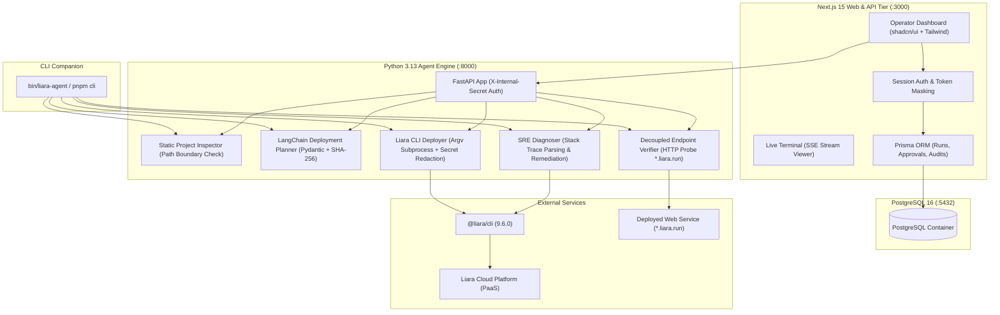

# Liara Deployment & SRE Agent

An autonomous AI agent designed for **Liara Cloud** to inspect projects, formulate structured deployment plans, execute operations with human-in-the-loop approval, and troubleshoot runtime failures through closed-loop SRE diagnosis.

---

## 1. System Architecture

The agent uses a two-tier hybrid architecture separating interactive web workflows and operator session security from autonomous AI orchestration and Liara CLI execution.



---

## 2. Core Autonomous Capabilities

The platform implements an end-to-end 6-step lifecycle accessible via both the **Web Dashboard** and the **CLI Companion**:

1. **Operator Setup & Token Management:**
   Secure login, masked Liara API token storage, and live connection verification against Liara Cloud projects.
2. **Static Project Inspection:**
   Inspects project codebases (e.g. `sample-apps/nodejs-demo`), identifies runtime platforms (`nodejs`), entrypoints (`server.js`), required ports (`3000`), and mandatory environment variables (`SERVICE_SECRET`).
3. **AI Deployment Planning & Human-in-the-Loop Gate:**
   LangChain orchestrates Pydantic structured output (`DeploymentPlan`), assesses billable and security impact, and signs the proposal with a deterministic SHA-256 cryptographic digest. Mutating actions are blocked until operator approval.
4. **Live Deployment & Real-Time Log Streaming:**
   Executes non-interactive `liara deploy` via argument arrays (`shell=False`) with live Server-Sent Events (SSE) streaming and real-time credential redaction.
5. **Decoupled Endpoint Health Verification:**
   Sends direct HTTP probes to `https://<app>.liara.run`, rigorously decoupling provider release status from actual application health. Detects startup crashes without false successes.
6. **Autonomous SRE Log Diagnosis & Approved Remediation:**
   Parses crash logs, cites the exact root cause line (`[FATAL] Missing required environment variable: SERVICE_SECRET`), formulates an actionable fix (`liara env:set`), and upon human approval, injects the secret and verifies HTTP 200 recovery.

---

## 3. Security Boundaries & Guardrails

- **Zero Plaintext Secrets:** Liara API tokens and injected secrets are masked in the UI, redacted in transit, and sanitized before persistence or SSE streaming.
- **Cryptographic Plan Digest:** Deployment plans and remediation proposals carry SHA-256 digests. Any out-of-band tampering invalidates the approval gate.
- **Subprocess Safety:** All CLI invocations use explicit argument arrays (`asyncio.create_subprocess_exec`) with strict timeouts; shell strings (`shell=True`) are forbidden.
- **Path Traversal Protection:** Static analysis enforces workspace containment boundaries and resolves symlinks, rejecting traversal attempts (`../`).
- **Internal Service Protection:** The Python Agent Engine requires an `X-Internal-Secret` header for all privileged operations.

---

## 4. Liara Capability & Feasibility Matrix

| Capability | Liara CLI / API Support | Agent Integration Status | Safety Boundary |
|---|---|---|---|
| Project Listing | REST API `GET /v1/projects` | Supported | Read-only |
| Static Code Analysis | Local filesystem inspection | Supported | Sandboxed / Read-only |
| Deployment Planning | LangChain Pydantic Structured Output | Supported | Cryptographic Digest Signed |
| App Deployment | CLI `liara deploy --app ...` | Supported | Human-in-the-loop Approval |
| Real-time Log Streaming | CLI Subprocess stdout / SSE | Supported | On-the-fly Token Redaction |
| Public Endpoint Health | HTTP Probe `https://<app>.liara.run` | Supported | Decoupled Provider vs App |
| Crash Log Ingestion | Subprocess capture / `liara logs` | Supported | Sanitized Bounded Log Window |
| Secret Injection Remediation | CLI `liara env set VAR=VAL -a ...` | Supported | Mandatory Operator Approval |

---

## 5. Quick Start

### Prerequisites
- **Docker & Docker Compose**
- **Node.js 20+**
- **pnpm 9+**
- **Python 3.11+**
- **Liara CLI** (`npm install -g @liara/cli`)

### Setup Steps
```bash
# 1. Clone repository
git clone git@github.com:amir-mostafahajisadeghian/aps-liara-ai-agent.git
cd aps-liara-ai-agent

# 2. Configure environment
cp .env.example .env
cp .env.example apps/web/.env

# 3. Start PostgreSQL container
pnpm db:up

# 4. Install Node dependencies & push Prisma schema
pnpm install
pnpm --filter web prisma:push

# 5. Initialize Python virtual environment
python3 -m venv engine/.venv
engine/.venv/bin/pip install --upgrade pip
engine/.venv/bin/pip install -e ./engine

# 6. Start full stack concurrently
pnpm dev
```

Visit the Web Dashboard at: **[http://localhost:3000](http://localhost:3000)**  
Sign in with operator credentials: `admin` / `change-this-password` (or configured in `.env`).

---

## 6. CLI Companion Usage

The CLI companion runs the identical workflow directly in your terminal:

```bash
# Show usage help
bin/liara-agent --help
# or via pnpm:
pnpm cli --help

# Statically inspect a project
pnpm cli inspect --path sample-apps/nodejs-demo

# Run full interactive workflow (Inspect -> Plan -> Approve -> Deploy -> Verify -> SRE)
pnpm cli run --path sample-apps/nodejs-demo --app demo-node-app

# Non-interactive mode (for CI/CD pipelines)
pnpm cli run --path sample-apps/nodejs-demo --app demo-node-app --yes
```

---

## 7. Rehearsed 5-Minute Video Demo Script

A detailed, time-coded presentation script for recording or presenting a 5-minute evaluation video is available in:
👉 [**`docs/DEMO_SCRIPT_5_MINUTES.md`**](docs/DEMO_SCRIPT_5_MINUTES.md)

---

## 8. Testing & Quality Verification

Run the entire test suite across Python engine, Next.js web application, and sample app:

```bash
# Run all tests (Python pytest + Web node:test)
pnpm test

# Python engine tests only (28 tests)
pnpm run test:engine

# Web tests only (13 tests)
pnpm --filter web test

# Standalone sample app crash verification
node sample-apps/nodejs-demo/test.mjs
```

---

## 9. Architectural Decision Records (ADRs) & Technical Guides

- [ADR-0001: Interface Prioritization for 2-Day MVP](docs/adr/0001-interface-prioritization-mvp.md)
- [ADR-0002: First End-to-End Deployment Target and SRE Scenario](docs/adr/0002-first-e2e-deployment-path.md)
- [ADR-0003: Hybrid Next.js Fullstack and Python LangChain Architecture](docs/adr/0003-hybrid-nextjs-python-architecture.md)
- [ADR-0004: AI Model Selection and Structured Orchestration](docs/adr/0004-ai-model-and-structured-orchestration.md)
- [ADR-0005: User Authentication and Credential Management](docs/adr/0005-authentication-and-credential-management.md)
- [Getting Started & Setup Guide](docs/GETTING_STARTED.md)
- [Live Deployment & SSE Log Streaming](docs/LIVE_DEPLOYMENT_AND_LOG_STREAMING.md)
- [Endpoint Verification & Health Decoupling](docs/ENDPOINT_VERIFICATION_AND_HEALTH_CHECK.md)
- [Autonomous SRE Diagnosis & Remediation](docs/SRE_DIAGNOSIS_AND_REMEDIATION.md)
- [5-Minute Demo Walkthrough Script](docs/DEMO_SCRIPT_5_MINUTES.md)

---

## 10. License
MIT
