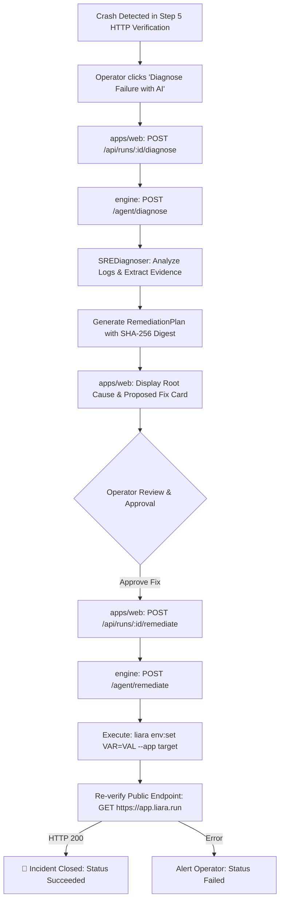

# Autonomous SRE Log Diagnosis & Approved Remediation

This document details the architecture, design decisions, and operational workflow for **Autonomous SRE Log Diagnosis and Approved Remediation** (Ticket 07) in the Liara Deployment & SRE Agent.

---

## 1. Overview & Objectives

In production cloud environments, applications frequently crash immediately after a deployment completes, even when the platform provider reports that the release succeeded (e.g. exit code 1 due to missing configuration or secret). 

Without an intelligent SRE agent, operators must:
1. Manually open cloud console logs or run `liara logs`.
2. Sift through hundreds of log lines to locate the stack trace.
3. Determine what environment variable or configuration is absent.
4. Manually run CLI commands (`liara env:set`) or navigate dashboards to fix it.
5. Re-check the public domain.

The Liara SRE Agent automates this loop with strict safety:
- **Autonomous Log Ingestion & Redaction:** Collects bounded crash logs and redacts credentials before analysis.
- **Evidence-Backed Root Cause Diagnosis:** Analyzes crash logs via LangChain or deterministic regex patterns, citing the exact failing line.
- **Human-in-the-Loop Approval Gate:** Proposes an actionable remediation plan (`liara env:set <VAR>=<VALUE>`) with a cryptographic SHA-256 digest, blocking execution until an authorized operator confirms.
- **Subprocess Execution & Public Endpoint Re-Verification:** Injects the approved secret via non-interactive argument arrays, restarts the workload, probes the public endpoint on `https://<app>.liara.run`, and confirms HTTP 200 health to close the incident.

---

## 2. Core Architecture



---

## 3. Data Models & Schemas

### `DiagnosisResult` (`engine/domain/models.py`)
```python
class RemediationAction(BaseModel):
    action_id: str = "remediate-missing-env"
    operation: Literal["set_env", "restart_app", "rollback"] = "set_env"
    target: str
    env_variable: str
    env_value: str = "default-service-secret-token"
    command_preview: str = ""
    requires_restart: bool = True

class DiagnosisResult(BaseModel):
    ok: bool = True
    root_cause: str
    error_evidence: str
    missing_variable: Optional[str] = None
    remediation: Optional[RemediationAction] = None
    digest: str = ""
```

---

## 4. Operational Safety Guarantees

1. **Subprocess Argument Arrays:**
   All CLI commands are executed without shell interpolation (`shell=False`):
   ```python
   args = ["liara", "env:set", f"{env_var}={env_val}", "--app", app_id]
   ```
2. **Double Secret Redaction:**
   Both the API token (`LIARA_API_TOKEN`) and the injected secret value (`env_val`) are scrubbed from stdout and audit logs before database persistence or SSE streaming.
3. **Cryptographic Verification of Plan Digest:**
   The remediation proposal includes a SHA-256 hash computed over `operation:target:env_variable:env_value`. Execution validates that the approval matches this digest.
4. **Audit Trail:**
   Every diagnosis, operator approval, and remediation execution is recorded in the PostgreSQL `AuditLog` table with timestamp and operator identity.

---

## 5. End-to-End Walkthrough

1. **Triggering the Crash Scenario:**
   - Deploy `sample-apps/nodejs-demo` without setting `SERVICE_SECRET`.
   - Step 5 HTTP probe against `https://<app>.liara.run` detects that the application crashed (e.g. 502/503 or ECONNREFUSED).
   - Step 5 displays: *"Deliberate SRE Scenario Detected: Provider Deployed But App Crashed"*.

2. **Diagnosing the Crash:**
   - Click **Diagnose Failure with AI** in Step 6.
   - The agent analyzes logs and outputs:
     - **Root Cause:** *"Application failed to start because the mandatory environment variable 'SERVICE_SECRET' is missing."*
     - **Exact Log Evidence Cited:** `"[FATAL] Missing required environment variable: SERVICE_SECRET"`.
     - **Target Variable:** `SERVICE_SECRET`.

3. **Approving & Applying the Fix:**
   - The UI presents the proposed remediation: `liara env:set SERVICE_SECRET=... --app demo-app`.
   - The operator reviews and customizes the secret value if desired.
   - Click **Approve Fix & Recover Service**.
   - The agent calls Liara CLI to set the secret, restarts the container, and verifies the public URL.
   - UI displays: **"🎉 Service Successfully Recovered! Incident Closed."**

