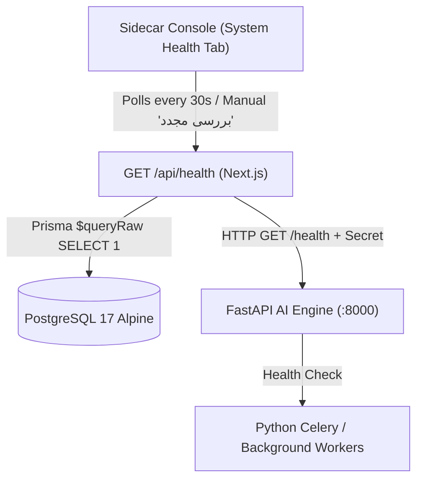

# System Health & Monitoring

The Liara AI Agent incorporates real-time health verification across all layers of the hybrid architecture. This prevents stale state, silently broken database connections, or uncommunicative backend engines.

---

## Architecture Overview

---

## 1. Health Endpoints

### Next.js BFF (`GET /api/health`)
- **Location**: `apps/web/src/app/api/health/route.ts`
- **Checks Performed**:
  1. **PostgreSQL 17 Database Connectivity**: Executes `SELECT 1` through Prisma ORM with a 3000ms timeout.
  2. **Python AI Engine Availability**: Sends an authenticated HTTP request to `http://127.0.0.1:8000/health` with `X-Internal-Secret`.
- **Response Structure**:
  - `status`: `"healthy"` if both database and engine are responsive; `"degraded"` if any component fails.
  - Returns individual component statuses, error messages, and timestamp.

### Python AI Engine (`GET /health`)
- **Location**: `engine/engine/main.py`
- **Checks Performed**:
  - Verifies engine process readiness, active threads, and internal state.
- **Response Structure**:
  - `{"status": "healthy", "service": "engine", "version": "0.1.0"}`

---

## 2. Sidecar Console UI Integration

The **System Health** tab in the sidecar console provides an intuitive interface for operators:
- **Automatic Polling**: Refreshes health status automatically every 30 seconds.
- **Manual Re-check (`بررسی مجدد`)**: Instantly re-probes both services with loading indicators.
- **Visual Status Badges**:
  - **Connected / Green**: Service is operational and low-latency.
  - **Disconnected / Red**: Service is unreachable or throwing errors. Detailed error message is displayed in a collapsible alert.
- **Fail-Safe Warnings**: When database or engine connectivity drops, the UI warns the user before allowing complex deployment or inspection operations.

---

## 3. Cloud Services Monitoring

The **Services** tab in the sidecar console manages live Liara Cloud state:
- **Interval**: Background auto-refresh polling every 60 seconds.
- **Manual Trigger**: Dedicated refresh button (`بروزرسانی سرویس‌ها`) forces an immediate sync with Liara's REST API.
- **Multi-Resource Sync**: Concurrently fetches both running web applications (`/v1/projects`) and managed databases (`/v1/databases`).
- **Workspace Filtering**: If a specific team workspace is selected in Account Settings, only services belonging to that workspace are retrieved.
